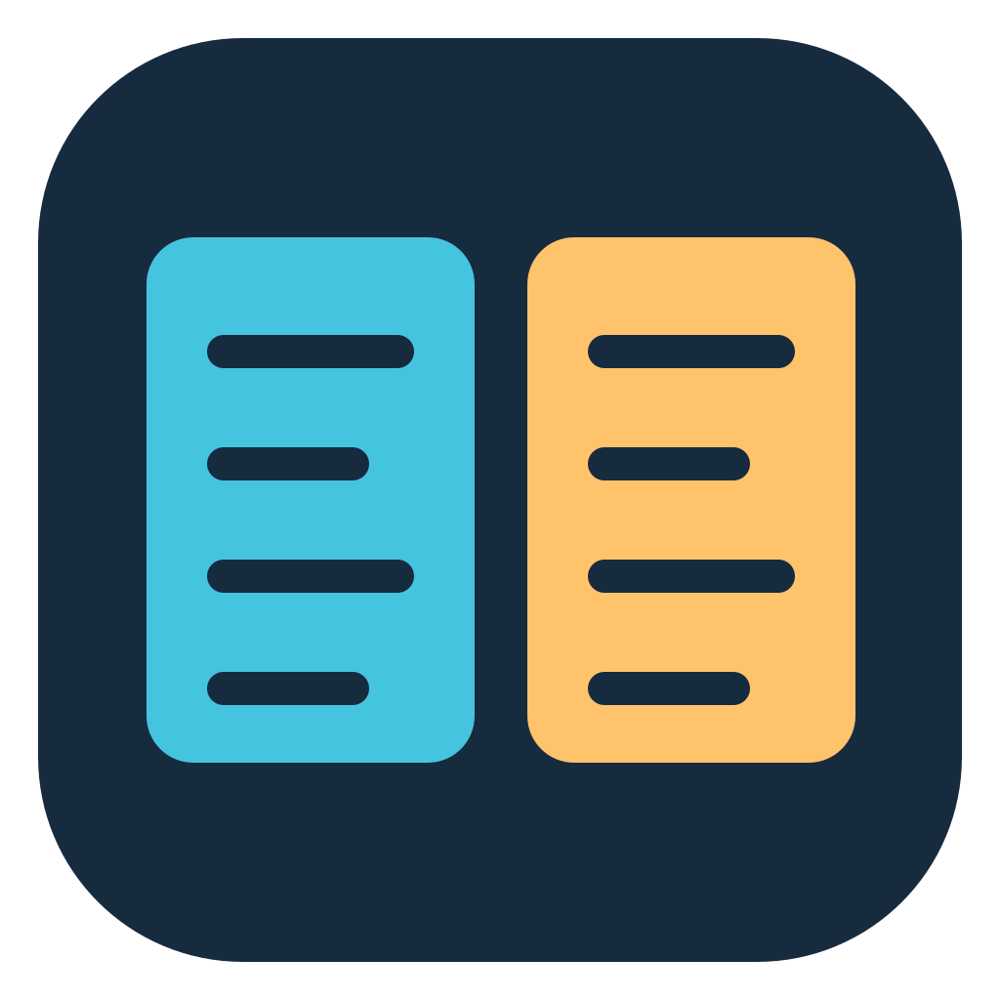

<p align="center">
  
</p>
<h1 align="center">DualCommander</h1>
<p align="center">
  <strong>Two panes. One file manager.</strong><br>
  For macOS, Windows, and Linux.
</p>
<p align="center">
  <a href="https://dualcommander.github.io/">Website</a> ·
  <a href="https://github.com/dualcommander/dualcommander/releases">Downloads</a> ·
  <a href="CONTRIBUTING.md">Contributing</a>
</p>

Browse folders side by side, manage files with keyboard shortcuts, and explore
archives without extracting them. Built in Go with [Fyne](https://fyne.io).

## Download

Download packages from [GitHub Releases](https://github.com/dualcommander/dualcommander/releases):

- macOS: arm64 (Apple Silicon) or amd64 (Intel), as `.dmg` or `.zip`.
- Windows: amd64.
- Linux: amd64, as `.deb`, `.rpm`, or `.tar.xz`.

Successful [GitHub Actions builds](https://github.com/dualcommander/dualcommander/actions/workflows/build.yml)
also provide downloadable workflow artifacts.

macOS and Windows packages are unsigned and not notarized; OS security prompts
still apply.

For macOS installation, open the DMG and drag DualCommander into Applications.

Linux packages are not self-contained: they use system graphics libraries and
require glibc 2.35 or newer. DEB targets Debian 12+, Ubuntu 22.04+, and Mint 21+;
RPM targets compatible Fedora/RHEL-family releases (not RHEL 9 or older).
These are compatibility targets, not a tested distro matrix. A desktop session
with OpenGL support is required. Install with `sudo apt install ./dualcommander-linux-amd64.deb`
or `sudo dnf install ./dualcommander-linux-amd64.rpm` so dependencies are resolved.

For building from source, testing, or packaging, see [CONTRIBUTING.md](CONTRIBUTING.md).

## Settings

Configuration lives in `~/.dualcommander/`, with no duplicated values:

- `settings.json`: Settings dialog controls—appearance, density, font size,
  pane view modes, hidden files, deletion/archive behavior, and external commands.
- `state.json`: current pane paths, active pane, sorting, and window size.
- `favourites.json`: starred paths as a JSON array of path strings.

Settings use section groups in `settings.json`:

```json
{
  "appearance": { "theme": "system", "density": "standard", "fontSize": "medium" },
  "views": { "left": { "brief": false }, "right": { "brief": false }, "showHidden": false },
  "deletion": { "moveToTrash": true },
  "archives": { "browse": true },
  "externalApplications": {
    "revealCommand": "", "terminalCommand": "", "editorCommand": "",
    "compareFilesCommand": "", "compareFoldersCommand": ""
  }
}
```

Configure F4 under **Settings > External applications > Edit file (F4)**.
Use a JSON argument list, e.g. `["code","--wait","{path}"]`; `{path}` is
the selected file and `{dir}` is the active pane folder. Commands run without
a shell, preserving spaces in file names. Leave blank for the OS default editor.

**File > Compare Files** compares the cursor file in each pane, ignoring marked
files. **File > Compare Folder Contents** passes the current left/right folders
to an external comparison tool. Both actions stay disabled until their command
is configured under **Settings > External applications**. Install your chosen
tool separately; use its executable on PATH or its full path.

Commands are JSON argument lists with both `{left}` and `{right}` placeholders.
Pane order stays fixed regardless of which pane is active. Examples:

- Files with VS Code: `["code","--diff","{left}","{right}"]`
- Files or folders with Meld: `["meld","{left}","{right}"]`

For folder comparison, configure your tool to compare contents recursively,
not only timestamps/sizes. DualCommander delegates comparison and its result UI
to that tool; it does not scan or compare files itself. Blank commands disable
their actions. Archives are unsupported. Exit code 1 is treated as differences
found; other nonzero exits report an error. Use a graphical tool or an explicit
terminal launcher for tools that need a terminal.

Session state uses nested objects in `state.json`:

```json
{
  "pane": {
    "active": "left",
    "left": { "path": "/home/user", "sort": "name" },
    "right": { "path": "/home/user/Documents", "sort": "name" }
  },
  "window": { "height": 700, "width": 1100 }
}
```

Legacy flat settings and state keys migrate automatically; nested values take precedence.

UI changes save automatically. Close DualCommander before editing files by hand;
changes load on the next start. Existing combined settings migrate automatically;
separate state and favourites files take precedence over legacy copies.
Existing Fyne preferences migrate when JSON files do not exist.
Missing keys use defaults; unknown keys are preserved. Invalid JSON or wrong
value types stop startup without overwriting the file. Writes use a temporary
file and replacement, with owner-only permissions on newly created files.

## Translations and logging

UI translations use Fyne's `lang` API, backed by
[go-i18n](https://github.com/nicksnyder/go-i18n). English ships today; the OS locale
selects supported languages, with English fallback. Add a go-i18n JSON catalog
named `<language>.json` alongside `en.json` in `internal/commander/translations/`
and rebuild. Catalogs are embedded, so installed applications need no extra files.
Use `lang.L` for new UI text; keep preference keys, command placeholders, paths,
and search-mode identifiers unchanged. Templates use named `{{.Field}}` values;
formatted messages retain their Go format verbs (which can use indexed arguments
such as `%[2]s` when a translation needs different ordering).

Application diagnostics use Go's standard `log/slog`, with structured text records
on stderr, timestamps, severity, and an `app=DualCommander` field. Startup/settings
failures and user-visible operation errors are logged. Logs remain untranslated.
No log files or rotation are created; redirect stderr when persistent logs are
needed. Error details can include local paths and external-tool stderr; review
logs before sharing them. Passwords and full command arguments are not explicitly
logged.

## Keyboard and mouse

`Mod` = Cmd on macOS, Ctrl on Windows/Linux. Commands are also available in the native menu bar.

| Key | Action |
| --- | --- |
| `Tab` | Switch pane |
| `Enter` | Open |
| `F4` | Edit in the OS text editor |
| `Shift+F4` | Create and select a new file |
| `Backspace` / `Mod+Up` | Go to parent folder |
| `Space` | Mark/unmark file or folder and sum size/file count (recursive for folders) without moving cursor |
| `Insert` | Mark item |
| `Mod+A` | Mark all |
| `Mod+Shift+A` | Unmark all |
| `F5` | Copy |
| `F6` | Move |
| `F2` / `Shift+F6` | Rename cursor item (`F2` on `..`: select current path) |
| `F7` / `Mod+Shift+N` | Create folder |
| `F8` / `Del` / `Mod+Backspace` | Delete to Trash/Recycle Bin; delete permanently if Trash is turned off in Settings |
| `Mod+,` | Open Settings |
| `Mod+1` | Brief view |
| `Mod+2` | Detailed view |
| `Mod+Shift+.` | Toggle hidden files |
| `Mod+Shift+R` | Reveal selection in Finder/Explorer/file manager; use current folder when nothing is selected |
| `F9` | Open terminal in current folder |
| `Menu` (application key) | Open cursor item's right-click menu |
| `Mod+U` | Swap panes |
| `Mod+E` | Open the same folder in the other pane |
| `Mod+F` / `Alt+F7` | Find files by name or content |
| `Ctrl+R` (also `Cmd+R` on macOS) | Reload active pane, preserving cursor and marks |
| `F10` | Quit |

| Mouse input | Action |
| --- | --- |
| Click | Set cursor |
| Right-click | Open, Open With / Get Info (macOS) or Properties (Windows), reveal, copy path |
| `Mod+click` | Toggle mark |
| `Shift+click` | Mark range |
| Click Name/Size/Date header | Sort ascending; click again to reverse (brief and detailed views) |

`F5` / `F6` / `F8` act on all marked items.

## Archives

Select a supported archive and press `Enter`, or double-click it, to browse its
contents in the current pane like a folder.
In Settings > Archives, turn off **Browse archives in DualCommander** to open
archives with the OS-associated application instead.

Supports ZIP, TAR, 7z, RAR, compressed TAR, and single-file compression formats
including gzip, bzip2, XZ, and Zstandard. Password-protected ZIP, 7z, and RAR are supported.

Archive browsing is **read-only**; nested archives are not browsed in-pane.
Opening a member creates a temporary copy (up to 256 MiB), removed on exit.
**Edits to that copy do not update the archive.**

DEB and RPM packages open with the OS-associated app, which may launch an installer.
Use an external tool to inspect them without installing.
